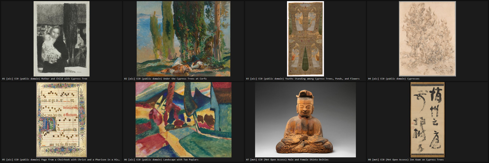

# Image deep research

Visual research for Claude: when a design question is better answered by
looking than by reading, Claude finds reference images on open, licensed
collections (Openverse, Wikimedia Commons, the Art Institute of Chicago, the
Met), keeps the creator and licence beside every image, looks at real
websites, and builds a moodboard you can use. It runs on the tools Claude
already has: web search, web fetch, and a browser when one is connected.

Install in Claude Code:

    /plugin install image-deep-research --marketplace ridelink0/image-deep-research

## Try it

- "Find twenty openly licensed photos of brutalist concrete interiors for a moodboard, commercial use allowed."
- "What ground colours and headline typefaces do six luxury watch websites use on their first screen?"
- "Build a moodboard of 1970s Japanese poster design from public-domain museum collections."

## Commands

- `/image-deep-research:find-reference-images` licensed images and a moodboard
- `/image-deep-research:website-contact-sheet` real sites, their colours, type and first screen

## Rules it keeps

Every image is opened before it is reported, and nothing without a licence
goes into a deliverable. A licence shown in search results is the source's
claim, so Claude reads it on the source page. It never signs in anywhere or
uses your credentials.

Ultimate Frontend Skills (github.com/ridelink0/ultimate-frontend-skills)
bundles a scripted version that also renders sites into contact sheets and
measures palettes. Install one or the other, not both.

Privacy: see PRIVACY.md. Licence: MIT.
